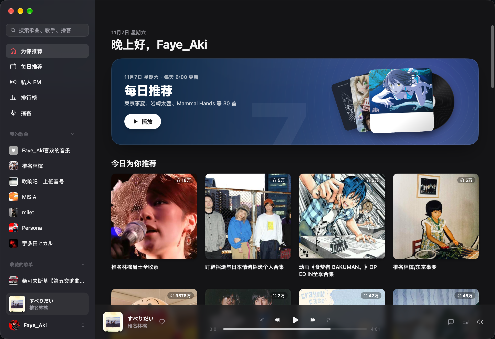
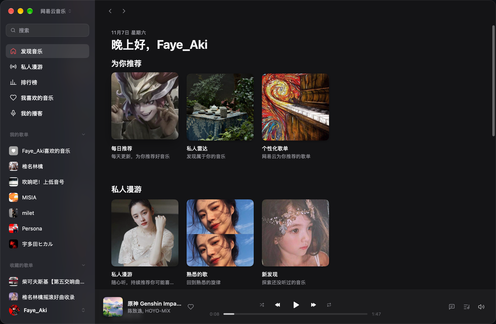
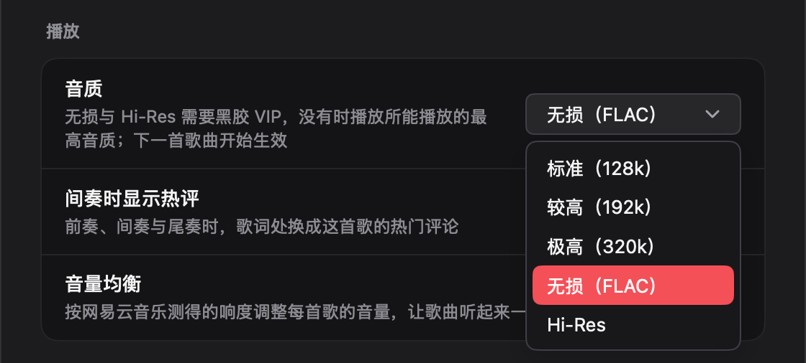
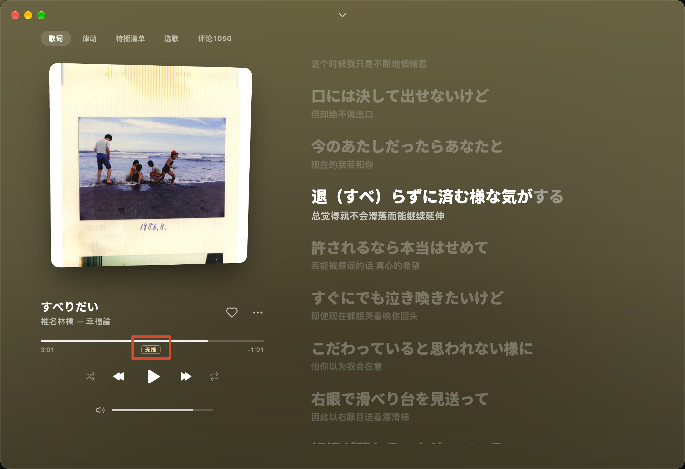
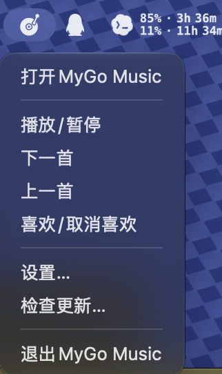
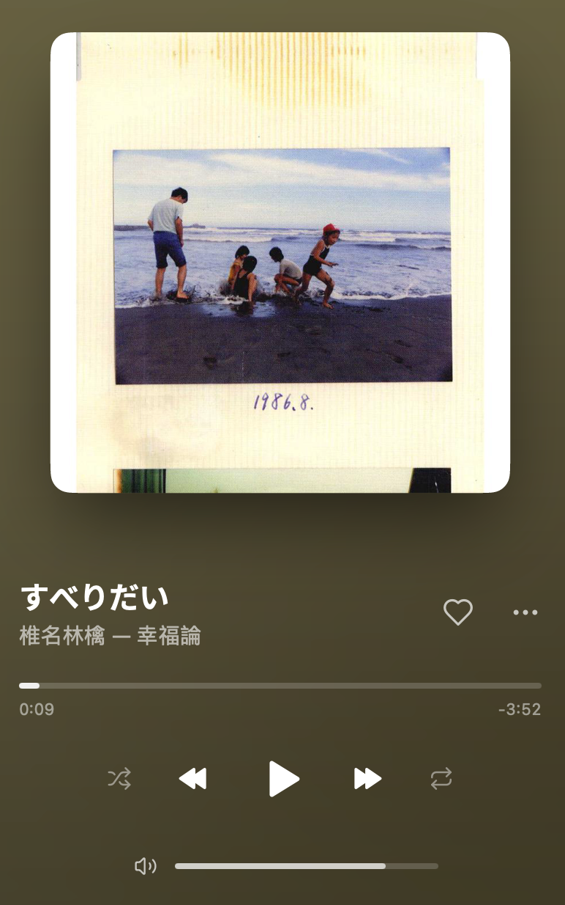

# MyGo Music Netease All 插件开发

我的电脑上启动了两个音乐播放器，接下来让我简单介绍下它们两个的区别：

一个是 MyGo 云音乐（后文简称为“原版”），它是最初的版本，原生支持通过扫码登录网易云音乐（后文简称为“官方”）来播放音乐资源，但是由于网易公司的原因，它不得不下线，成为了“绝版”软件，我电脑上保留着它当时最新的版本。

另一个是 MyGo Music（后文简称为“新版”），它是原作者做出的一个通用播放器，支持插件生态，当前已经使用第三方插件来实现了最基本的网易云音乐资源播放，歌单同步的功能。

[MyGo Music 开源仓库](https://github.com/egoist/mygo-music)

[MyGo 开源框架仓库](https://github.com/egoist/mygo)

[登录插件仓库](https://github.com/sogud/mygo-music-netease)

我的想法是自己开发一个插件来尽可能还原以前的 MyGo 云音乐的深度适配。新版仓库中有对插件开发的实例和一些文档。

[Netease All 代码仓库](https://github.com/Faye-bit/MyGo-Music-Netease-All.git)

## 插件的替代范围

新插件需要完整替代目前正在使用的网易云音乐登录插件，而不是依赖它运行的附加插件。安装新插件后，应当可以停用现有插件，独立完成网易云音乐的登录、音乐播放和歌单同步。

具体要求包括：

- 支持网易云音乐扫码登录、登录状态保存、退出登录，以及登录失效后的重新登录。
- 同步账号下的自建歌单、收藏歌单和“我喜欢的音乐”，读取歌单中的歌曲，并支持刷新同步结果。
- 保留现有插件提供的其他功能，以当前使用版本的实际功能清单为验收基线，不能只实现首页和音质增强而遗漏原有能力。
- 在上述完整替代能力的基础上，进一步改善个性化推荐、首页展示和音质适配。

“完整替代”是功能要求，不意味着必须从零重写；可以在遵守原项目许可证的前提下，复用或改进现有插件实现。歌单同步中涉及的写回操作，以现有插件实际支持的能力为准，在开发前明确验收清单。

## 新版及其插件做的不够好的地方

在 MyGo Music 上，我初步体验下来，发现了几处做得不如原版的地方：

1. 首页非个性化推荐，日推、私人雷达等功能封面错误，且没有好的排版和动效，体验下来很差；

	原版首页有日推的独立排版，鼠标滑上去还有精美的动效，下方的推荐歌单也都是官方个性化推荐的。
   
  
  新版首页不仅日推的封面是错误的，而且排版稀碎，下方的推荐歌单也是毫无依据的乱推荐（应该是默认的游客推荐？）
   
  
2. 新版没有实现对原版一样，音质的高度适配。原版可以在设置中选择默认播放音质，可以选择播放黑胶专属音质（VIP），能获取更好的音质体验。

   
     且播放页还会显示当前播放的音质。
   

## 主程序改造：菜单栏播放卡片

播放卡片计划直接实现在 MyGo Music 主程序中，不作为网易云音乐插件的一部分。它应当读取播放器统一的当前歌曲和播放状态，适用于网易云音乐、其他音乐源和本地音乐。

由于 MyGo Music 是开源软件，可以在其源码基础上开发该功能，并通过 Issue 讨论需求和方案，再通过 PR 向上游提交实现。插件增强与主程序改造分别推进，播放卡片不作为新插件独立运行的前提。

当前的任务栏菜单，只能控制音乐的播放暂停、上一首/下一首等基础功能，甚至连当前播放的音乐信息都没能展示出来。

我想对其进行重制，改造为一个播放小卡片，可以显示当前播放音乐的封面、歌手等信息，同时还能进行控制操作等等。下图截取自新版的播放页面，可以作为样式参考。

## 第一阶段交付（2026-11-08）

正式插件：网易云音乐 All 0.1.0，独立 ID `netease-all`，支持基线 MyGo Music 0.1.22。源码与安装说明见 [plugin/README.md](plugin/README.md)，安装包为 [netease-all-0.1.0.zip](netease-all-0.1.0.zip)。保留原插件与只读验证版作为回退，不迁移旧会话。

实现了独立扫码及会话保护、完整歌单 ID 分批补详情、分页与顺序保护、喜欢/歌单写入后云端核对，并保留原 22 个公开能力。`npm run check` 和 36 项模拟测试通过；开发命令是 `npm test`、`npm run package`。实机结果和未验证项见 [第一阶段验收记录](docs/验收记录-阶段1.md)。尚未宣布全部替代验收通过，首页增强与五档音质仍待后续阶段。

GitHub 安装：在 MyGo Music「设置 → 插件 → + → 从 GitHub」填写 `Faye-bit/MyGo-Music-Netease-All`。仓库根目录的 `plugin.json` 指向 `plugin/index.js`；本地 Zip 仍使用包内的单文件入口。版本为 **0.1.0**，对应标签 `v0.1.0`。

## 第二阶段交付（2026-11-08）

网易云音乐 All **0.2.0** 已实现首页日推大卡片、真实推荐封面、登录后的个性化歌单、分区失败隔离、按账号/中国日期缓存、手动刷新与请求合并，以及私人漫游去重和停止保护。保留原有插件入口与三档播放协议，第三阶段音质任务尚未开始。

安装包：[netease-all-0.2.0.zip](netease-all-0.2.0.zip)，校验：[SHA-256](netease-all-0.2.0.zip.sha256)。本机已升级本插件并验证日推卡片、详情、首曲播放与下一首顺序；未改动登录存储。完整记录及前后截图见 [第二阶段验收记录](docs/验收记录-阶段2.md)。官方客户端对照、真实跨日与第二个真实账号的雷达差异仍未验证。

0.2.0 为第二阶段初版；上方第一阶段版本和标签为历史交付记录，当前修订见下文。远端是否提供本版以实际推送/发布状态为准。

### 首页修订 0.2.1

按实机反馈移除首页「刷新首页推荐」卡片；排行榜和三种私人漫游加入独立主题封面，图片随包分发，不预取推荐歌曲。强制刷新仍可通过插件设置触发。

当前安装包：[netease-all-0.2.1.zip](netease-all-0.2.1.zip)；根清单版本为 **0.2.1**，历史 0.2.0 包保留。

### 首页精简 0.2.2

移除首页底部「账号」分区及其中的「账号与同步」卡片，保留侧栏同步入口。当前安装包：[netease-all-0.2.2.zip](netease-all-0.2.2.zip)。

原版四列大卡片需要修改 MyGo 主程序：宿主按可用宽度及 156 DIP 最小卡片宽度计算列数，插件 Section 协议没有尺寸/列数选项。按用户决定，本次只完成插件调整，卡片尺寸留到单独的主程序任务处理。

### 日推导航与文案 0.2.3

侧栏加入日历图标的「每日推荐」，移除「我喜欢的音乐」和「账号与同步」入口；喜欢歌单仍保留在「我的歌单」，同步页可通过底部账号进入。每日推荐页展示日期、星期、歌曲数和更清晰的标题说明，复用首页同批日推。当前安装包：[netease-all-0.2.3.zip](netease-all-0.2.3.zip)。

日期封面内部排版、虚化强度、标题标签颜色由主程序绘制，插件协议没有相应样式选项；本版未修改主程序，未宣称还原原版视觉。
